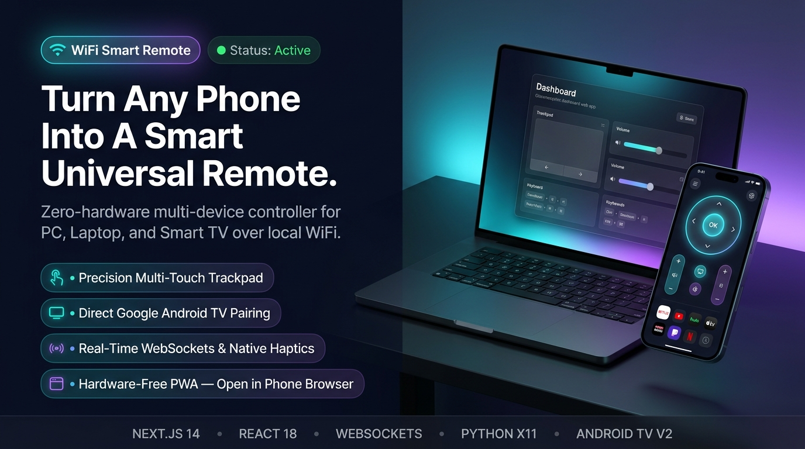
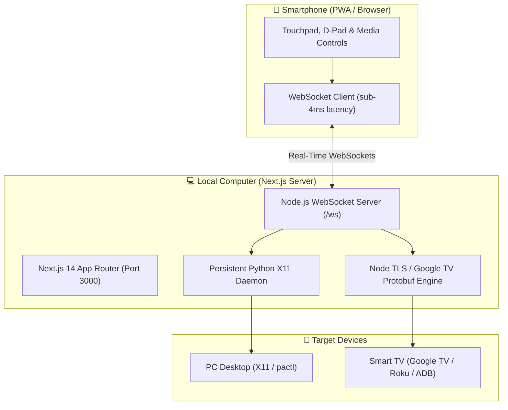

<div align="center">

# 📱 WiFi Smart Remote
### Universal Zero-Hardware Controller for PC, Laptop & Smart TV

[](https://nextjs.org/)
[](https://react.dev/)
[](https://www.typescriptlang.org/)
[](https://github.com/websockets/ws)
[](https://python.org)
[](https://github.com/AYUSHTRIPATHI0)
[](https://sitekraft.dev)

<br/>

<p align="center">
  
</p>

<p align="center">
  <b>Turn any smartphone (iOS / Android) into an ultra-low-latency universal smart remote over your local WiFi.</b>
  <br/>
  <i>No physical hardware (ESP8266 / Arduino / IR blasters) required. Pure software engineering.</i>
</p>

---

</div>

## 🌟 Why WiFi Smart Remote?

Existing remote apps suffer from critical limitations:
1. **Physical Universal Remotes**: Need custom hardware boards, IR blasters, or microcontrollers.
2. **Traditional Desktop Remotes**: Suffer from high touch latency, complex client installations, and laggy cursor movements.
3. **Smart TV Remote Apps**: Inundated with full-screen ads, subscription paywalls, or require complicated ADB / Developer Mode setups.

**WiFi Smart Remote** solves all of this with a sleek, self-hosted Next.js 14 Progressive Web App (PWA) powered by real-time WebSockets and native system integrations.

---

## ⚡ Core Features

### 💻 1. PC & Laptop Controller Mode
* **Multi-Touch Trackpad**:
  * **1-Finger Drag**: Ultra-smooth 60+ FPS mouse tracking (sub-4ms ping latency).
  * **1-Finger Tap**: Left Click.
  * **2-Finger Tap**: Right Click.
  * **2-Finger Drag**: Two-way momentum scrolling.
  * **Tactile Buttons**: Dedicated Left, Middle, Right click, and **Drag Lock** (for text selection or moving windows).
* **Media & Audio Control**:
  * Volume Up (+5%), Volume Down (-5%), and Mute toggle via native PulseAudio (`pactl`).
  * Play / Pause, Seek -10s, Seek +10s, Fullscreen (`F`), and Escape (`Esc`).
* **Smartphone-to-PC Keyboard**:
  * Type text on your mobile phone and send it directly into any active PC window.
  * Essential keys: Backspace, Tab, Enter, Windows/Super key.
  * Global shortcuts: `Ctrl+C` (Copy), `Ctrl+V` (Paste), `Alt+Tab` (Window Switcher).
* **Presentation Clicker (PPT Mode)**:
  * Ergonomic slide navigation (Previous Slide / Next Slide).
  * Slideshow toggle (`F5`) and Black Screen (`B`).
* **Quick Launchers & Security**:
  * One-tap launch: YouTube, Netflix, Web Browser.
  * One-tap **Lock PC** screen session.

---

### 📺 2. Smart TV Controller Mode
* **Google Android TV Remote Protocol v2 (Direct PIN Code Pairing)**:
  * Connects over encrypted TLS (ports `6466` & `6467`).
  * **Zero Developer Mode / ADB Required**: TV automatically displays an on-screen 6-character PIN code (`4A8B9C`). Enter the PIN once in the web app, and you are permanently paired!
  * Compatible with **Android TV, Google TV, Sony, Mi TV, OnePlus, TCL, Realme, Xiaomi, and Chromecast**.
* **Roku TV External Control Protocol (ECP)**:
  * Zero-auth instant control over HTTP port `8060`.
* **Legacy ADB Mode**:
  * Fallback ADB over WiFi (port `5555`) for developer devices.
* **Ergonomic Circular D-Pad**:
  * Up, Down, Left, Right arrows surrounding a prominent neon-accented **OK / Select** button.
* **Full TV Navigation**:
  * Back, Home, Menu, Exit, Play/Pause.
* **Volume & Channel Rockers**:
  * Dedicated Vol (+/-), Channel (+/-), Mute, and TV Power toggle.
* **Numpad (0-9)**:
  * Fast channel number input for set-top boxes.
* **Direct App Launch**:
  * 1-tap TV app open: YouTube, Netflix, Amazon Prime Video, Spotify.
* **Local WiFi TV Auto-Scanner**:
  * Scans your local subnet to automatically discover active TVs and displays them for 1-tap connection.

---

### 📱 3. Mobile PWA & Instant Pairing
* **Zero App Store Installation**:
  * Progressive Web App (PWA). Open the local IP in Chrome or Safari, tap **"Add to Home Screen"**, and it launches as a full-screen native mobile app.
* **Instant QR Code Pairing**:
  * Open the web app on your laptop to display a clean QR code. Scan with your phone's camera to pair immediately.
* **HTML5 Haptic Vibration**:
  * Tactile vibration feedback on button presses and touchpad taps (`navigator.vibrate`).
* **Adjustable Preferences**:
  * Configurable trackpad sensitivity (0.6x to 3.0x) and scroll inversion.

---

## 🛠️ Architecture & Tech Stack



* **Frontend**: Next.js 14 (App Router), React 18, TypeScript, Tailwind CSS, Lucide Icons
* **Real-Time Layer**: Node.js `ws` (isolated `/ws` upgrade handler, zero HMR collision)
* **Desktop Automation**: Python 3 ctypes (`libX11.so.6`, `libXtst.so.6`), `pactl` (PulseAudio), `xdg-open`
* **Smart TV Engine**: `androidtv-remote` (Google TV Protocol v2 TLS/Protobuf), Roku ECP HTTP, ADB
* **Utilities**: `qrcode`, PWA Web App Manifest, HTML5 Vibration API

---

## 🚀 Getting Started

### Prerequisites
* **Node.js** v18+ (tested on Node v20/v22)
* **Python** 3.8+ (Linux with X11 / `libXtst.so.6`)

### 1. Clone & Install
```bash
git clone https://github.com/AYUSHTRIPATHI0/wifi-remote-.git
cd wifi-remote-
npm install
```

### 2. Build & Run
```bash
./start.sh
```
Or manually:
```bash
npm run build
node server.mjs
```

### 3. Connect from Phone
1. Ensure your smartphone is connected to the **same WiFi network** as your computer.
2. Open your phone's browser and navigate to the displayed local IP:
   ```text
   http://<YOUR_LOCAL_IP>:3000
   ```
   *(Or scan the QR code displayed in the **QR & Pair** tab).*
3. In browser options, select **"Add to Home Screen"** for full-screen standalone app mode.

---

## 🛡️ Firewall Configuration (Linux UFW)

If your smartphone cannot load the page, your Linux firewall (`ufw`) may be blocking incoming connections on port `3000`. Run the following command on your computer:

```bash
sudo ufw allow 3000/tcp
```

---

## 📺 Pairing with Your Smart TV

1. Ensure your TV and computer are on the same WiFi network.
2. Open the **Smart TV** tab in the remote.
3. Tap **Auto-Detect TV** (or manually enter your TV's IP address, e.g. `192.168.1.184`).
4. Tap **Pair / Connect**:
   * A 6-character PIN code will appear on your TV screen (e.g. `4A8B9C`).
   * Enter the code in the phone prompt and tap **Confirm PIN**.
5. Your remote is now permanently paired!

---

## 👨‍💻 Author & Branding

<div align="center">

**Ayush Tripathi**  
*Founder, [Sitekraft.dev](https://sitekraft.dev)*  

[](https://github.com/AYUSHTRIPATHI0)
[](https://sitekraft.dev)

*Crafted with passion for high-performance software engineering and seamless connected home experiences.*

</div>

---

## 📄 License

This project is licensed under the [MIT License](LICENSE).
